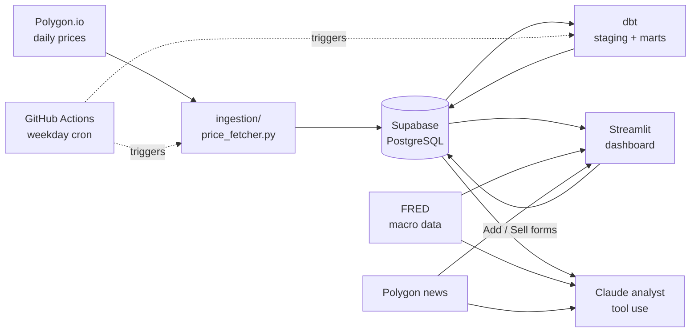

# PortfolioOS
 
**A personal investing platform built on a modern data stack: daily market data in, tested dbt models in the middle, a live dashboard and a Claude-powered analyst on top.**
 
<!-- TODO: add a screenshot of the dashboard here, e.g.  -->
<!-- TODO: add the live Streamlit link here once you decide to share it -->
 
I spent nine years in fund accounting, where cost basis, realized vs. unrealized P&L, and benchmark comparisons are daily work. PortfolioOS applies that domain knowledge to a full pipeline: ingest, transform, test, automate, and ask questions in plain English.
 
---
 
## What it does
 
- **Ingests** daily prices for 560+ tickers from Polygon.io into Supabase (PostgreSQL) with a single grouped API call
- **Transforms** raw data with dbt: staging views plus six mart tables for positions, summary, sector exposure, benchmark comparison, market movers, and realized P&L
- **Automates** the daily load and `dbt run` with GitHub Actions every weekday at 4:30 PM ET, plus a lightweight workflow that refreshes the marts within about 30 seconds of a trade
- **Visualizes** everything in a Streamlit dashboard: portfolio KPIs, sector exposure, a sector treemap of market movers, news, and FRED economic indicators
- **Answers questions** through a Claude API analyst that uses tool calls against the same live data, with multi-turn memory
- **Records trades** through Add/Sell Position forms. New tickers are auto-registered and backfilled with a year of price history
---
 
## Architecture
 

 
## Stack
 
| Layer | Tool |
|-------|------|
| Data sources | Polygon.io, FRED |
| Database | Supabase (PostgreSQL) |
| Transformation | dbt (staging views, mart tables) |
| Dashboard | Streamlit, Plotly |
| AI layer | Claude API with tool use |
| API layer | FastAPI (optional, not used by the dashboard) |
| Automation | GitHub Actions |
| Language | Python 3.12 |
 
---
 
## Design decisions worth knowing about
 
**Prices come from the last completed trading day, never "today."** Polygon's free tier rejects same-day grouped data with a 403. I confirmed this with a direct request instead of trusting the docs, then changed the fetcher to always target the prior trading day.
 
**The movers mart filters split artifacts.** Polygon back-adjusts historical prices for splits, so an older row can predate the adjustment and create a fake overnight 2x or 0.5x "move." `market_movers` uses a `LAG` window for day-over-day change and excludes any move of 50% or more.
 
**Realized P&L uses weighted average cost; lot deduction uses FIFO.** The `realized_pnl` mart computes cost basis per ticker and account across all buy lots. When a sale is recorded, FIFO decides which lot rows are reduced or removed. Keeping the two concerns separate keeps the accounting transparent.
 
**The dashboard talks to Supabase directly.** An earlier design routed everything through FastAPI. Calling Supabase, Polygon, and FRED directly lets the dashboard deploy standalone on Streamlit Cloud with no extra server. The API layer still exists but nothing depends on it.
 
**The AI analyst is a tool-use loop.** `analyze()` lets Claude call tools for positions, movers, news, and macro data, feeds the results back, and repeats until Claude finishes. The caller owns the message history, so the same function powers both the CLI and the dashboard chat.
 
---
 
## Data model
 
**Source tables (Supabase):** `stocks`, `price_history`, `fundamentals`, `portfolio` (one row per buy lot), `sales` (one row per sell).
 
**dbt marts:** `portfolio_positions`, `portfolio_summary`, `portfolio_sector_exposure`, `portfolio_vs_spy`, `market_movers`, `realized_pnl`.
 
---
 
## Project structure
 
| Folder | Purpose |
|--------|---------|
| `ingestion/` | Daily price fetcher and historical backfill |
| `dbt/` | Staging models and portfolio marts |
| `dashboard/` | Streamlit app |
| `analysis/` | Claude API portfolio analyzer |
| `api/` | Optional FastAPI service |
| `schema/` | Database schema |
| `scripts/` | Seed data and dataset-building notebooks |
| `.github/workflows/` | Daily pipeline and post-trade mart refresh |
 
---
 
## Run it yourself
 
1. Create a Supabase project and apply the schema in `schema/`.
2. Copy your keys into a `.env` file: `SUPABASE_URL`, `SUPABASE_KEY`, `POLYGON_API_KEY`, `ANTHROPIC_API_KEY`, `FRED_API_KEY`.
3. Install and run:
```bash
pip install -r requirements.txt
python -m ingestion.price_fetcher          # load prices
dbt run --project-dir dbt/                 # build marts (needs a finance_platform profile)
streamlit run dashboard/app.py             # launch the dashboard
python -m analysis.portfolio_analyzer      # or ask questions from the terminal
```
 
---
 
## Status
 
Phases 1 to 9 are complete: ingestion, dbt layer, dashboard with Market Movers, News, and Economic Indicators tabs, the Claude analyzer with multi-turn history, Add/Sell Position forms, and the realized P&L mart.
 
**Next:** expand dbt tests (reconciliation checks such as positions summing to the portfolio total, and no negative share counts) and add CI that runs `dbt test` on every pull request.
